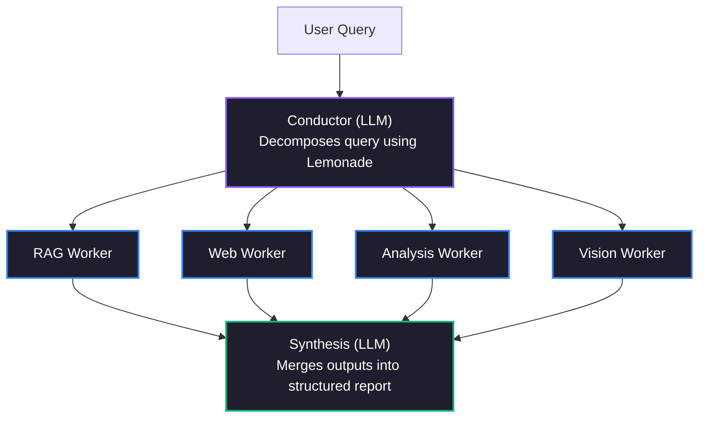

# 🐝 SwarmMind — Multi-Agent AI Research on AMD Lemonade 🍋

> **AMD Lemonade Developer Challenge 2026 Submission**  
> A local-first, multi-agent research swarm **Powered by Lemonade Omni Models**  
> *Built as a deep ecosystem contribution to push local, multi-agent AI forward on AMD hardware.*
>
> **Challenge status:** Submitted and awaiting review — not yet selected. See [docs/CHALLENGE-STATUS.md](docs/CHALLENGE-STATUS.md) for verified status and next steps.

> ### 🆕 New here? [Start the 5-minute quickstart →](docs/QUICKSTART.md)
> Clone → install → run → get a cited report in minutes. Having trouble? See [Troubleshooting](docs/TROUBLESHOOTING.md).

[](https://python.org)
[](https://github.com/lemonade-sdk/lemonade)
[](LICENSE)

---

### 🎥 [Watch the SwarmMind Demo Video Here!](https://arorlgyiqvelbjrtshjn.supabase.co/storage/v1/object/public/pranav/1784638692_swarmmind_demo_1080p.mp4)
**🌐 Read this in your language:** [简体中文](docs/README.cn.md) | [हिन्दी](docs/README.hi.md) | [日本語](docs/README.ja.md) | [Français](docs/README.fr.md)

---

## 🎯 What is SwarmMind?

SwarmMind is a **multi-agent AI research assistant** that decomposes complex research queries into parallel sub-tasks, runs specialised worker agents concurrently, and synthesises a structured report — all running **100% locally** on AMD hardware via the [Lemonade SDK](https://github.com/lemonade-sdk/lemonade).

### The Swarm Architecture



---

## ✨ Features

- **🧠 Multi-Agent Orchestration** — Conductor decomposes queries; parallel workers research independently
- **🔍 RAG (Retrieval-Augmented Generation)** — ChromaDB for private document search
- **🌐 Web Search** — DuckDuckGo integration for real-time web results
- **⚡ Parallel or Sequential Execution** — Choose parallel (fast) or sequential (low-RAM) worker execution
- **🖥️ AMD Hardware Detection** — Auto-detects Ryzen AI NPU, ROCm GPU, and recommends optimal backends
- **🎨 Lemonade Omni Models** — Native multimodal processing! Leverages Qwen3.6-35B-A3B for Vision, Flux for Diagrams, and Kokoro for TTS narration.
- **📊 Structured Reports** — Executive summary, sections, contradictions, follow-up questions
- **🔊 Read Aloud** — Opt-in "Read aloud" button narrates a report with Lemonade TTS, generated locally on your own machine
- **🔗 Grounded Citations** — Stable `[S#]` source IDs, clickable citation markers, a grounding badge and a Sources appendix with the exact supporting snippet
- **🧪 Quality & Evaluation** — Deterministic, offline golden-set metrics with an optional independent (blinded) LLM judge — see [docs/EVALUATION.md](docs/EVALUATION.md)
- **📤 Export** — Markdown and HTML report export with inline citations and a run manifest
- **🖥️ Professional UI** — Dark glassmorphism design with 3-panel layout, live source-status refresh and source-first loading

---

## 🚀 Quick Start

> **Judge?** See the [Setup Guide](SETUP.md) for detailed instructions.

### Prerequisites

1. **AMD Lemonade** installed and running:
   ```bash
   pip install lemonade-sdk
   lemonade-server start
   ```

2. **Python 3.11+** with uv or pip

### Installation

```bash
git clone https://github.com/rahulgupta0-dev/swarmmind.git
cd swarmmind

# Create virtual environment
python -m venv .venv
source .venv/bin/activate

# Install with dev dependencies
pip install -e ".[dev]"

# Verify installation
swarmmind --help
```

### Run

```bash
# Launch the Streamlit web UI
swarmmind web

# Or run a CLI query
swarmmind ask "What is AMD Ryzen AI?"

# Or run the smoke test (requires Lemonade server)
bash tests/smoke_test.sh
```

Open http://localhost:8501 in your browser.

> **No AMD hardware?** You can still run the full CLI and UI pipeline against the
> bundled mock server. Start it in a separate terminal with
> `.venv/bin/python tests/mock_lemonade_server.py` (port 13305; override with
> `MOCK_PORT`) in place of `lemonade-server start`. It returns canned responses
> and does not validate real AMD hardware or model quality. See the
> [5-minute quickstart](docs/QUICKSTART.md) and
> [troubleshooting](docs/TROUBLESHOOTING.md).

---

## 🔧 Configuration

SwarmMind stores configuration at `~/.swarmmind/config.toml`:

```toml
[lemonade]
host = "localhost"
port = 13305
api_key = ""              # Optional Bearer token for Lemonade v2026.47.1+

[models]
conductor = "Qwen3.6-35B-A3B-GGUF"
worker = "Gemma-4-12B-it"
embeddings = "nomic-embed-text-v1-GGUF"
image = "Flux-2-Klein-4B"
tts = "kokoro-v1"

[rag]
chunk_size = 512
chunk_overlap = 64
top_k = 5

[execution]
mode = "parallel"        # "parallel" (fast) or "sequential" (low-RAM)
max_concurrent = 4        # Limit parallel workers (1-16)
```

### Lemonade API key (v2026.47.1+)

Lemonade v2026.47.1+ can require authentication — an empty `LEMONADE_ADMIN_API_KEY`
no longer bypasses it. Set the token as `lemonade.api_key` in `config.toml`, or
export `LEMONADE_API_KEY` (falling back to `LEMONADE_ADMIN_API_KEY`). SwarmMind
sends `Authorization: Bearer <key>` only when a key is present, so older,
unauthenticated servers keep working unchanged. See
[docs/COMPATIBILITY.md](docs/COMPATIBILITY.md).

### Hardware auto-detection

SwarmMind queries Lemonade's `/v1/system-info` endpoint and routes each model role
to the best available backend:

| Hardware | Backend | Use Case |
|---|---|---|
| AMD Ryzen AI NPU (XDNA 2) | `ryzenai` | Conductor (low-latency) and embeddings (low-power, steady-state) |
| AMD Radeon GPU (ROCm) | `rocm` | Conductor & workers (high-throughput) |
| AMD CPU (llama.cpp) | `cpu` | Fallback / TTS |

Pin backends manually in `config.toml`:

```toml
[models.backends]
conductor = "rocm"
worker = "rocm"
embeddings = "ryzenai"
image = "rocm"
tts = "cpu"
```

### Execution mode

Two worker execution modes accommodate different hardware:

| Mode | Speed | RAM Usage | Best For |
|---|---|---|---|
| `parallel` (default) | ⚡ Fast — workers run simultaneously | Higher — multiple LLM calls at once | 32 GB+ RAM (Strix Halo, high-end GPUs) |
| `sequential` | 🐢 Slower — one worker at a time | Lower — single LLM call at a time | 8-16 GB RAM (laptops, older hardware) |

```bash
# CLI: Force sequential mode
swarmmind ask "Compare RAG vs fine-tuning" --sequential

# Config: Set via config.toml
[execution]
mode = "sequential"
max_concurrent = 1
```

In the **Web UI**, toggle execution mode in the **Settings** panel (left sidebar).

---

## 🏗️ Architecture

```
swarmmind/
├── core/
│   ├── orchestrator.py  # Main pipeline coordinator
│   ├── conductor.py     # Query decomposition (LLM)
│   ├── workers.py       # RAG / Web / Analysis / Code workers
│   ├── synthesis.py     # Multi-worker report synthesis (LLM)
│   └── hardware.py      # AMD hardware detection & backend routing
├── lemonade/
│   └── client.py        # Async Lemonade API client
├── rag/
│   └── chroma_store.py  # ChromaDB RAG implementation
├── data/
│   └── database.py      # SQLite project/conversation storage
└── ui/
    ├── app.py           # Streamlit app entry point
    └── panels/
        ├── chat.py      # Research query & results panel
        ├── sources.py   # Project & source management
        └── studio.py    # Export, notes & Lemonade status
```

---

## 📝 AMD Lemonade Integration (v2026.47+ Compatible)

SwarmMind targets current Lemonade Server releases (v2026.45.3 → v2026.48.x)
through the OpenAI-compatible `/v1/*` API, including Bearer-token authentication
and the friendlier 400/405 error handling. The legacy v11.5.0 endpoints below
(health, load, classify, inference, embeddings) remain supported. See
[docs/COMPATIBILITY.md](docs/COMPATIBILITY.md) for the release-by-release matrix.

SwarmMind integrates with the following Lemonade endpoints:

| Endpoint | Purpose |
|---|---|
| `GET /v1/health` | Connection health check with `is_busy` & `is_streaming` state parsing and `403` origin diagnostics |
| `POST /v1/chat/completions` | All LLM inference (conductor, workers, synthesis, Lemonade Router traces) |
| `POST /v1/classify` | Lemonade Router ONNX text-classification & fast sub-task routing |
| `POST /v1/load` | Pre-load conductor and worker models |
| `POST /v1/embeddings` | RAG document embedding |
| `GET /v1/system-info` | AMD hardware detection (NPU/GPU/CPU) |
| `GET /v1/stats` | Token throughput metrics |

---

## 💻 CLI Reference

| Command | Description |
|---|---|
| `swarmmind doctor` | Diagnose Python, config, server, models and local setup |
| `swarmmind ask <query>` | Run a research query from the terminal |
| `swarmmind ask <query> --no-web` | Disable web search for this query |
| `swarmmind ask <query> --sequential` | Run workers sequentially (safer on low-RAM systems) |
| `swarmmind ask <query> --project-id <id>` | Scope query to a specific project's sources |
| `swarmmind ask <query> --json` | Emit the report as pure JSON on stdout (diagnostics go to stderr) |
| `swarmmind project create <name>` | Create a new research project (auto-generated UUID ID) |
| `swarmmind project create <name> --id <id>` / `-i <id>` | Create a project with a custom, URL-friendly ID |
| `swarmmind project list` | List all projects |
| `swarmmind source add <project> <type> <uri>` | Add a source (pdf, youtube, web, text) |
| `swarmmind source list <project>` | List sources in a project |
| `swarmmind report list <project>` | List past reports for a project |
| `swarmmind config show` | Show current configuration (including `lemonade.api_key`) |
| `swarmmind benchmark` | Run AMD cross-backend benchmark |
| `swarmmind eval` | Run the offline golden-set quality evaluation (deterministic metrics) |
| `swarmmind eval --report` | Print the Markdown evaluation report |
| `swarmmind eval --report --judge` | Add the approximate secondary judge (a different, blinded model) |
| `swarmmind eval --output report.md` | Write the Markdown evaluation report to a file |
| `swarmmind web` | Launch Streamlit web UI |

---

## 🧪 Quality & Evaluation

SwarmMind reports are **source-grounded**: every `[S#]` marker maps to a stable
source ID in a per-run registry, and reports carry a `grounding` summary,
`stop_reason`, `rounds_used`, `query` and `timestamp`. The UI renders citations
as clickable links to source cards (title, kind badge, URL/path and the exact
snippet), shows a grounding badge, and streams source cards as workers finish.

Quality is measured with `swarmmind eval`, an **offline, deterministic-primary**
harness over an 8-query golden set with local source documents. It checks valid
citation IDs, source retrievability, quoted-span match, unsupported-claim count
and source diversity. An optional **secondary** LLM judge (a *different*,
blinded, order-randomized model) adds approximate faithfulness and answer
relevance scores — it never judges its own generator's output and never
replaces the deterministic metrics.

```bash
swarmmind eval --report                 # deterministic metrics only
swarmmind eval --report --judge         # + approximate secondary judge
swarmmind eval --output eval-report.md  # save Markdown
```

Every run records a **run manifest** (models, backends, config snapshot,
timestamp, stop reason) for a one-command re-run. See
[docs/EVALUATION.md](docs/EVALUATION.md) for the method, metric definitions,
golden set and caveats, and [docs/REPRODUCIBILITY.md](docs/REPRODUCIBILITY.md)
for manifests and the privacy note (web search/page fetch are opt-in).

---

## 📄 License

Apache 2.0 — see [LICENSE](LICENSE) for full terms.

---

## 📚 Documentation

| Document | Description |
|---|---|
| [Quickstart](docs/QUICKSTART.md) | Clone-to-cited-report in 5 minutes (incl. no-AMD mock server) |
| [Setup Guide](SETUP.md) | Judge setup instructions, detailed configuration |
| [Troubleshooting](docs/TROUBLESHOOTING.md) | Symptom → cause → exact fix, `swarmmind doctor` first |
| [CHANGELOG.md](CHANGELOG.md) | TDD audit fixes and methodology |
| [CHALLENGE-STATUS.md](docs/CHALLENGE-STATUS.md) | Verified challenge status, judging patterns and action plan |
| [ECOSYSTEM-RESEARCH.md](docs/ECOSYSTEM-RESEARCH.md) | AMD ecosystem and community research behind the submission |
| [COMPATIBILITY.md](docs/COMPATIBILITY.md) | Lemonade release compatibility matrix (v2026.45.3 → v2026.48.x) |
| [EVALUATION.md](docs/EVALUATION.md) | Evaluation method, metrics, golden set and caveats |
| [REPRODUCIBILITY.md](docs/REPRODUCIBILITY.md) | Run manifest, one-command re-run and privacy note |
| [README.md](README.md) | Architecture, features, CLI reference |

---

*Built with ❤️ for the AMD Lemonade Developer Challenge 2026*
